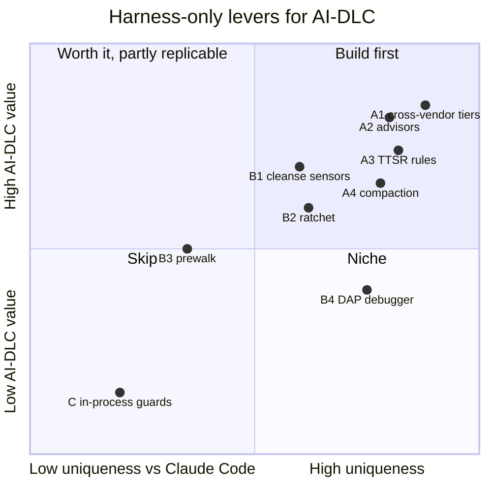

# What the Coding Harness can give AI-DLC users that Claude Code cannot

Baseline compared: Claude Code **2.1.293** (installed, `claude --version`) and its current docs
(`code.claude.com/docs/en/{hooks,plugins/mods/*,sub-agents,tools-reference,model-config,prompt-caching,advisor,plugins-reference}`),
against the harness at `~/projects/coding-harness` (1.0.0, plus H1/H2 from SPEC.md).
Every "Claude cannot" claim cites the doc line or tool list it rests on; `[INFERENCE]` marks unverified claims.

## 0. Bottom line

Claude Code now ships **mods**: in-process JS middleware that can rewrite system-prompt sections, swap model and effort per request, choose a subagent's model, register tools and commands, call models on the side, and draw UI.
Most "harness-only" ideas from the earlier plan are therefore **not** differentiators anymore (§1).
The real advantages fall into five areas:

1. **Any model from any vendor, per stage.** This includes local and air-gapped models.
2. **Continuous, tool-equipped, cross-vendor advisors** watching AI-DLC agents.
3. **Stream-time rule enforcement (TTSR).** Rules fire before a violation reaches a file or tool.
4. **Extension-owned compaction**, triggered at AI-DLC stage boundaries.
5. **Host subsystems that map onto AI-DLC stages:** cleanse, ratchet, the DAP debugger and prewalk.

There is also a strategic point: the user owns both the methodology and the host core, so missing seams become patches (H1–H3), not feature requests.

## 1. No longer differentiators (Claude Code 2.1.293 has an equivalent)

| Earlier candidate | Claude Code equivalent | Source |
|---|---|---|
| In-process extension API | Mods: functions in a plugin "that Claude Code calls in its own process" | mods/overview "Compare mods…" |
| Per-turn constitution/system-prompt injection | `prompt.compose` → `{sections}`, `prompt.section` → `{text}`, `prompt.context` → `{blocks}` | mods/reference "Prompts and what Claude reads" |
| Per-request model/effort routing | `turn.step` → `next({...e, model})`, `next({...e, effort})` | mods/reference "Turns" |
| Per-subagent model at spawn | `agent.spawn` → `next({...e, model})` or `{deny}` | mods/reference "Subagents" |
| Typed native tools / commands | `$.tool.register`, `$.command.register` | mods/reference "Mods API methods" |
| Side-turn reviewers | `$.model.complete/fork/classify`, `$.agent.spawn` | mods/api |
| TUI dashboards | Panes, bands, `AskUserQuestion` re-render, `$.ui.*` | mods/reference "Render sites", "Elements" |
| LSP diagnostics after edits | Plugin `lspServers` with `diagnostics` (default `true`: "push diagnostics into context after edits"); `LSP` tool | plugins-reference L341; tools-reference |
| Worktree isolation for bolts | Subagent `isolation: worktree`; `EnterWorktree` | sub-agents L317; tools-reference |
| Multi-agent orchestration | `Workflow` tool, agent teams, `Monitor` | tools-reference |
| Exact usage/cost | `$.session.usage()` → `{context, rateLimits, cost}`; `turn.step` result usage | mods/reference |
| Cache survival across approval waits | `promptCacheTtl: 1h` (main session and subagents) | prompt-caching L259–291 |
| Plugin evaluation | `claude plugin eval` with a no-plugin baseline arm | `claude plugin --help` |
| Mods in headless/CI | Mods run in `claude -p` and the Agent SDK | mods/overview "Where mods run" |

Two consequences for the AI-DLC fork:
- The Claude distribution could itself move from settings hooks to a mod. The harness adapter (SPEC §6) is not ahead on *seams*, only on what follows below.
- In-process execution saves little. On this machine each `aidlc engine hook` spawn costs about 37–40 ms (10 runs: 0.37–0.40 s). The Claude distribution fires 5 PreToolUse and 3 PostToolUse hooks per Edit/Write, but runs matched hooks in parallel ("All matching hooks run in parallel", hooks reference L419). So the saving is CPU plus about 80 ms per edit. Not worth ranking.

## 2. Ranked differentiators

Effort: **S** ≈ ≤1 day, **M** ≈ 2–4 days, **L** ≈ a week+ `[INFERENCE: estimates]`.
Measurement uses a merge-cost screening protocol: run on the 8 highest-variance tasks, 1 run per arm against the baseline. Keep an idea only if it wins at least 6 of 8 on merge cost or hidden tests and the difference is visible in 3 diffs. Survivors are confirmed on 20 fresh tasks. The end-to-end build (SPEC.md) verifies each item with live scenarios instead; screening is optional follow-up.

### A1 — Cross-vendor model routing per AI-DLC tier and stage
- **Mechanism.** AI-DLC tiers (`deciding`, `reviewing`, `writing-up`, inherit) resolve to *any* provider's model, with ordered fallbacks. That includes 14 core providers plus dozens of hosted ones (`docs/providers.md` §Core/§Additional) and local engines (Ollama, llama.cpp, LM Studio; `docs/providers.md` §Built-in local engines). Path-scoped `disabledProviders` hard-fences providers per directory, for example local-only for client repos (`docs/providers.md` §Path-scoped).
- **Harness seams:**
  - agent frontmatter `model: [patterns…]` and `thinking-level` (SPEC E05);
  - `before_subagent_spawn` → `{model, block}` (`extensibility/extensions/types.ts:855`, result at 1301) for escalation, e.g. re-spawning a failed developer bolt on a stronger model from another vendor;
  - `modelRoles`.
- **AI-DLC hooks:**
  - E06 tier table gains vendor-diverse presets: `reviewing` → a different vendor than the builder, `writing-up` → cheap open-weight;
  - doctor validates the presets resolve.
- **Claude Code.** Claude models only: "`ANTHROPIC_BASE_URL` changes where requests are sent, not which model answers them" (model-config L23). `turn.step` and `agent.spawn` choose among Claude models.
- **Value:**
  - independent review: a reviewer from another model family does not share the builder's blind spots `[INFERENCE: to be measured]`;
  - cost on mechanical stages;
  - data residency for regulated codebases, which is an AI-DLC enterprise selling point.
- **Effort:** S on top of SPEC E05/E06.
- **Measure.** Screen arm "xreview": AI-DLC reviewer on another vendor vs same-vendor reviewer. Metrics: merge cost, hidden tests, $/task. This can be screened **before** P3 with plain harness subagents (no AI-DLC needed).

### A2 — Continuous cross-vendor advisors bound to AI-DLC agents
- **Mechanism.** Harness advisors are separate model sessions that watch the primary transcript, investigate with their own tools (default `read`/`grep`/`glob`, configurable up to mutating tools), and inject concise advice:
  - cadence via `reviewMode: turn|agent-end` and `reviewInterval`;
  - backlog sync policy;
  - eviction of stale tool results;
  - persisted `__advisor.<slug>.jsonl` transcripts and a cost ledger.

  Source: `docs/advisor-watchdog.md` §WATCHDOG.yml, §Cost.
- **Harness seams:**
  - per-agent frontmatter `advisor: true | "<model>[:level]"` (§Subagents) works in the H1 host agent dir with **no footprint change**;
  - roster and instructions from `WATCHDOG.yml`/`WATCHDOG.md`, today discovered only at the repo root or `.harness/` (so H3 adds `watchdogPaths`);
  - implementation in `src/advisor/*` and `session/session-advisors.ts`.
- **AI-DLC hooks:**
  - `emit-agents.ts` writes `advisor:` on `aidlc-developer-agent` (and optionally other agents) from a new tier `advising`;
  - a generated `WATCHDOG.md` `@`-imports the *approved* design, NFR and test-strategy artifacts of the active intent, so the advisor checks construction against what the human approved, turn by turn, not only at stage end.
- **Claude Code.** The advisor tool is server-side and single. It is consulted when Claude chooses, is "experimental and requires the Anthropic API", and is "not available on Amazon Bedrock … Agent Platform, or Microsoft Foundry" (advisor.md). A mod could approximate a per-turn reviewer with `turn.complete` + `$.model.fork`, but only on Claude models and without native cadence, tool isolation or backlog control.
- **Value:** shifts AI-DLC review left, from stage gate to in-flight; matches hook-screening idea 2 (a different model as checker).
- **Effort:** S (frontmatter) + S (WATCHDOG generation) + H3.
- **Measure.** Screen arm "advisor-xvendor" on construction tasks. Metrics: merge cost, review findings at the AI-DLC gate (fewer is better), advisor $ share.

### A3 — AI-DLC contracts as stream-time rules (TTSR)
- **Mechanism.** Rules carry:
  - conditions: a regex `condition`, an ast-grep `astCondition` or a judged `question`;
  - `scope`: text, thinking, any tool, a named tool, or a tool with path globs;
  - `agents`;
  - `interruptMode`: `always | prose-only | tool-only | never`.

  On a match the harness aborts the stream immediately. It then drops the partial output (`contextMode: discard`), injects `<system-interrupt reason="rule_violation" …>` and retries. AST checks run against the edit's reconstructed source in `beforeToolCall`, so violations are blocked **before side effects** (`docs/ttsr-injection-lifecycle.md` §1–4).
- **Harness seams:** `session/ttsr-coordinator.ts`, `TtsrManager`, rule frontmatter (`docs/rulebook-matching-pipeline.md`). Rules load only from `.harness/rules/` and `RULES.md` (`discovery/builtin.ts:394–416`), so H3 must add `resources_discover.rulePaths` to keep the footprint inside `.harness-aidlc/`.
- **AI-DLC hooks.** The builder compiles a `rules/ttsr/` set from AI-DLC contracts and the test strategy:
  - no stubs or placeholders (`throw new Error("not implemented")`, `TODO: implement`) in construction outputs;
  - a `jest.mock($$$)` or `vi.mock($$$)` AST condition when the approved test strategy forbids mocks;
  - writes to `aidlc/**/state.md` (scope `tool:edit(aidlc/**)`);
  - reviewer agents emitting edits (`agents: [aidlc-reviewer-agent]`);
  - a judged `question` for "claims tests pass without having run them". That is hook-screening idea 1 (evidence gate) applied to prose.

  Sensors stay as the post-write net. TTSR is the pre-emission net.
- **Claude Code:**
  - `tool.call` can deny a *finished* tool call;
  - `turn.step` exposes model and effort swaps and stream forwarding;
  - no documented hook interrupts prose or thinking mid-stream and discards the partial message (mods/reference "Turns").

  `[INFERENCE]` A determined mod could buffer `turn.step` output, but discard-and-retry with injected context is not an exposed contract.
- **Value:** fewer wasted turns and sensor round trips; cleaner context (violations never land in history).
- **Effort:** M (H3 + rule compiler + per-strategy rule selection).
- **Measure.** Screen arm "ttsr-contracts". Metrics: sensor failures per task, turns per task, merge cost, interrupt count.

### A4 — Engine-owned compaction at stage boundaries
- **Mechanism.** `session_before_compact` may return a complete `compaction` result plus `preserveData`, honored at `session/session-maintenance.ts:1256–1271`, or `cancel`/`prompt`/`context`. `ctx.compact()` triggers it.
- **Why not per-request shaping.** The harness `context` event (`extensibility/extensions/runner.ts:1969`, called per request from `sdk.ts:4156`) could rewrite history on every request, but changing earlier messages invalidates the provider prompt cache from that point on. So shaping happens only at compaction, which already resets the prefix.
- **AI-DLC hooks:**
  - compaction text is generated deterministically from engine state: current stage and directive, `aidlc-state.md`, the approved-artifact index with paths, open questions, the pending gate;
  - no LLM summary, so no workflow-position drift; `continue-workflow` has less to repair;
  - stage transitions trigger compaction when context usage is above a threshold, dropping superseded exploration once its artifacts are approved.
- **Claude Code:**
  - `session.compact` → `{skip}` only; PreCompact can block;
  - the summary is model-written (prompt-caching L176);
  - `session.append` rewrites rows *before storage* (permanent), not per request (mods/reference "Session").
- **Value:** long multi-stage runs keep their place; lower tokens per construction turn.
- **Effort:** M.
- **Measure.** Scripted long bugfix→feature run with forced compaction (SPEC T3 S9 extended). Metrics: post-compaction directive errors, tokens per stage, merge cost.

### B1 — Checker discovery to AI-DLC sensors (cleanse)
- **Mechanism.** `harness cleanse` discovers project checkers with a prompted discovery agent, then streams diagnose-while-dispatching with verification. Output is normalized across checker formats (`src/cleanse/{agent,loop,parsers,types}.ts`; options `request`, `all`, `includeTests`, `model`, `maxAgents`).
- **AI-DLC hook:** a new core sensor `project-checks` runs project checkers from `aidlc/spaces/<space>/checkers.json`. The harness discovers that config with the cleanse checker-discovery contract through `/aidlc-checkers`. The existing `linter` sensor covers eslint on TS/JS only; upstream defers multi-language detection.
- **Claude Code.** No built-in checker discovery appears in the tools reference. A skill could imitate it, so uniqueness is medium.
- **Effort:** M. **Measure:** hook-screening idea 5 (project checkers), sensor coverage per project.

### B2 — Ratchet the AI-DLC method itself
- **Mechanism.** `/ratchet` arms an eval-kernel hill climb whose rules are enforced host-side, so the model cannot argue with them:
  - a frozen stratified train/test split;
  - baseline gate;
  - per-round `keep|revert|rerun`;
  - held-out leakage and completeness checks;
  - approval freshness by content hash.

  Source: `ratchet/ratchet.ts` header and lines 23, 308–347; command at `slash-commands/builtin-modes.ts:248`.
- **AI-DLC use:**
  - hill-climb skills, stage rules, agent prompts and TTSR rule sets against fixture tasks with hidden tests (SPEC.md §9 B2).
- **Claude Code.** `claude plugin eval` scores cases against a no-plugin baseline. It has no host-enforced keep/revert loop with a frozen held-out split (`claude plugin --help`).
- **Effort:** M. **Spend:** each round costs eval money, so it needs approval.

### B3 — Prewalk at the plan-approval gate
- **Mechanism.** A one-shot handoff from the planning model to a cheaper one once implementation starts (`docs/prewalk.md`; `--prewalk-into <model|role>`, any vendor). An extension can also call `pi.setModel` (`types.ts:1621`).
- **AI-DLC hook:** when `plan-approval-guard` sees the plan approved, switch the construction executor to the `executing` tier.
- **Claude Code.** Replicable with `turn.step` within Claude models, so only the cross-vendor part is unique.
- **Effort:** S. **Measure:** $/task vs merge cost on construction tasks.

### B4 — DAP debugger in the bugfix scope
- **Mechanism.** A native `debug` tool over DAP: read-only state inspection vs exec-tier launch/step/evaluate (`tools/debug.ts`, `src/dap/*`).
- **AI-DLC hook:** the bugfix scope's root-cause stage (E14 harness host text) directs breakpoint-driven reproduction before fixes.
- **Claude Code.** No debugger tool in the 45-tool reference list (tools-reference).
- **Effort:** S. **Measure:** bugfix-task subset, time to root cause, fix correctness.

### C — Niche or low value

| Item | Why it is low |
|---|---|
| Model-invoked `checkpoint`/`rewind` for reverse-engineering stages | Subagents give similar context isolation in Claude Code. |
| Hashline / `ast_edit` precision edits | Measurable (edit failure rate), but not AI-DLC-specific. |
| Mnemopi/hindsight memory ↔ AI-DLC learnings | Claude has auto memory and subagent `memory:`. |
| `cache_warming_decision` during approval waits | Claude offers a 1 h TTL. |
| In-process engine guards | See §1: about 80 ms and some CPU per edit. |
| `if-bench` to qualify cheap models for the directive loop | Useful once A1 exists. |
| `harness compress` for AI-DLC method text | Host-neutral output; helps both distributions. |

## 3. Harness changes these need (SPEC.md §7)

Verification found that the harness never emits `resources_discover`: the event is typed and the runner can emit it, but nothing calls it. `docs/extensions.md` says so. So the harness needs three changes:
- **H1** wires the event into session creation and adds `agentPaths`.
- **H3** adds `rulePaths` (rules feed the rulebook and TTSR buckets) and `watchdogPaths` (advisor discovery).
- **H2** handles coexistence with the Claude distribution.

All three ship in harness 1.1.0, with a fourth, **H4**: a skill an extension contributes replaces another tool's skill of the same name, so the harness `/aidlc` wins over Claude Code's in a project that carries both distributions.

## 4. Where each item is specified

SPEC.md §9 has the granular design and acceptance scenarios (S17–S22) for A1–A4, B1–B4 and B2. Build order is SPEC.md §10, phase P6.

## 5. As built

Every item is built and verified live on Coding Harness 1.1.0; STATUS.md has the evidence and SPEC.md "As built" lists where the build differs from the plan.

| Item | What shipped | Live check |
|---|---|---|
| A1 | Reviewer subagents are routed at spawn to a model family other than the builder's (`harness.reviewDiversity`, `harness.reviewPool`) | S17 |
| A2 | `advisor: true` on the developer; the advisor's brief inlines the human-approved artifacts | S18 |
| A3 | Four shipped rules (no stubs, state files, read-only reviewers, evidence) plus rules derived from the method and the active scope | S19a, S19 |
| A4 | The compaction summary is built from the workflow record; a stage boundary compacts past `harness.compactAtStageBoundary` | S9, S9b |
| B1 | A core `project-checks` sensor running the commands in `aidlc/spaces/<space>/checkers.json`, and `/aidlc-checkers` to discover them | S20 |
| B3 | `prewalk: true` on the developer; harness-native overrides | S21 |
| B4 | Debugger-first diagnosis in a bugfix, held by a derived rule on the first source edit | S22 |
| B2 | `ratchet/aidlc-method`: 15 cases with hidden tests, runner, grader, and an RPC driver for `/ratchet` | STATUS.md |
